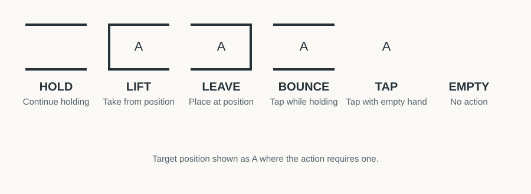
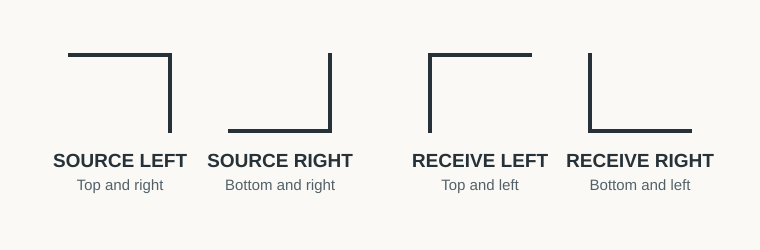
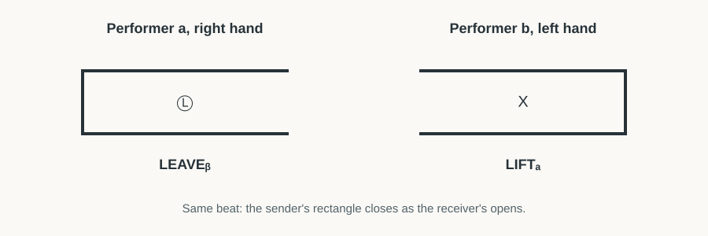

# POINTS Notation

## 1. Basic Concept

POINTS describes table juggling: one or more performers manipulate objects at defined positions over time. Solo juggling is the basic form; passing extends it to multiple performers.

## 2. Positions

In solo juggling, three positions are arranged in front of the performer:

| Symbol | Position |
|---|---|
| $A$ | Left |
| $B$ | Middle |
| $C$ | Right |

A position can be empty or occupied by a ball.

The hands also have special positions:

| Symbol | Meaning |
|---|---|
| $L$ | Back of the left hand |
| $R$ | Back of the right hand |

How positions are assigned to performers in passing depends on the passing system.

## 3. Time and Hands

A pattern is organised into beats. Each performer has a sequence for each hand. Every cell specifies that hand's action at that point in time.

The time signature must be given, for example $3/4$ or $4/4$. Beats can be subdivided using conventional music counting:

| Subdivision | Count |
|---|---|
| Quarter notes | $1\;2\;3\;4$ |
| Eighth notes | $1\;\&\;2\;\&\;3\;\&\;4\;\&$ |
| Sixteenth notes | $1\;e\;\&\;a\;2\;e\;\&\;a$ |

The ampersand marks the midpoint between beats. The syllables $e$ and $a$ mark the two additional sixteenth-note subdivisions.

## 4. Actions

| Action | Meaning |
|---|---|
| HOLD | Keep holding the object without acting. |
| LIFT | Lift an object from the target position. |
| LEAVE | Leave an object at the target position. |
| BOUNCE | Tap a position while holding an object. |
| TAP | Tap a position with an empty hand. |
| EMPTY | No action. |
| SPECIAL | Perform an action not covered by the other types. |

The symbols are formed from the borders of a cell. A target position is shown inside the cell where the action requires one.

SPECIAL can represent actions such as a clap. A clap requires both hands to be free during that beat.

## 5. Ball Rectangles

A rectangle represents one ball over time while it is held by a hand. It is opened by LIFT and closed by LEAVE. HOLD and BOUNCE can extend the rectangle between those actions. The rectangle remains straight and continuous across the beats. It does not trace a path between table positions.

TAP is independent of a ball rectangle because it is performed with an empty hand. EMPTY has no symbol.

## 6. ZIP

ZIP transfers an object between the two hands of the same performer. It combines a source action and a receiving action at the same beat. Its direction determines which hand sends and which receives.

The four ZIP symbols are distinguished by which pair of cell borders is shown:

## 7. Passing

Passing extends POINTS to multiple performers. It can be written in two ways.

### 7.1 Circle Passing

Each performer has their own positions $A$, $B$ and $C$, and everyone follows the same sequence. A subscript identifies a position belonging to another performer:

| Notation | Meaning |
|---|---|
| $A$ | Position A of the acting performer |
| $A_{\mathrm L}$ or $A_{1\mathrm L}$ | Position A of the performer one place left |
| $A_{\mathrm R}$ or $A_{1\mathrm R}$ | Position A of the performer one place right |
| $A_{2\mathrm L}$ | Position A of the performer two places left |

The same applies to $B$ and $C$. The letter identifies the position; the subscript identifies the performer relative to the acting performer. The number gives the distance. An omitted number means one, so $\mathrm L=1\mathrm L$ and $\mathrm R=1\mathrm R$.

It is called circle passing because performers can, for example, sit in a circle and address their left and right neighbours.

### 7.2 Individual Passing

Performers have individual hand sequences and can pass directly to one another. Positions may be separate for each performer or shared on one common layout. A shared layout is optional.

Each performer is assigned a lowercase letter, such as $a$, $b$ or $c$. This identifier is written as a subscript to name the other performer involved in a pass.

A pass consists of:
- A LEAVE action directed into the receiving hand. A circled hand symbol means into the hand, not onto its back.
- A simultaneous LIFT action by the receiver, using $X$ as the target to identify the receiving hand.

The subscript on each action identifies the other performer. For example, a pass from the right hand of performer $a$ to the left hand of performer $b$ uses:
- In $a$'s right-hand row: LEAVE with circled $L$, subscript $b$.
- In $b$'s left-hand row: LIFT with target $X$, subscript $a$.

The sender's rectangle closes as the receiver's rectangle opens in the same beat:

This can also describe a transfer that functions like a ZIP between performers. A transfer between the hands of one performer uses ZIP instead.

## 8. Reading a Pattern

Read each action in the context of its performer, hand, beat, target position and the current distribution of objects.
